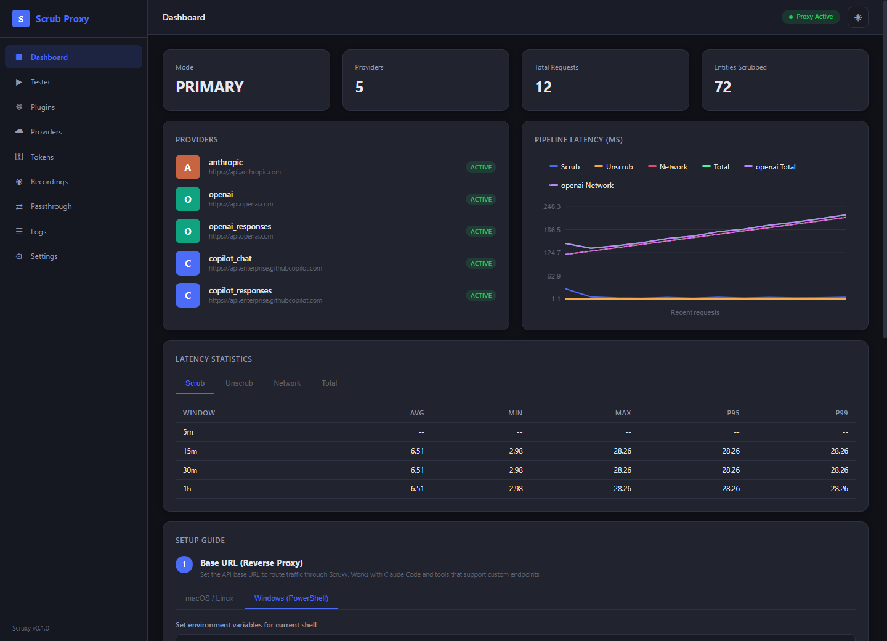
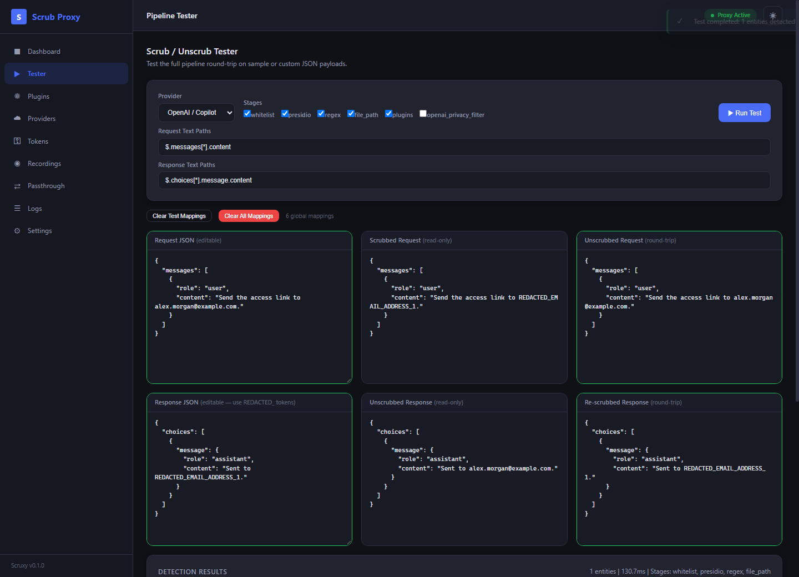
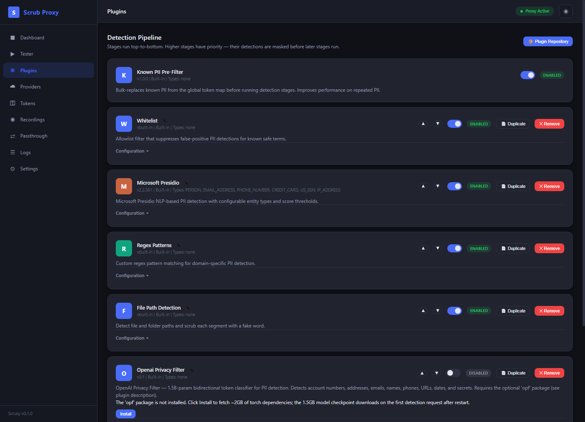
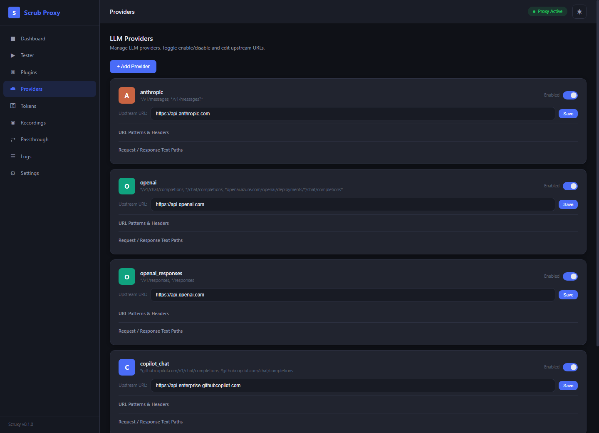
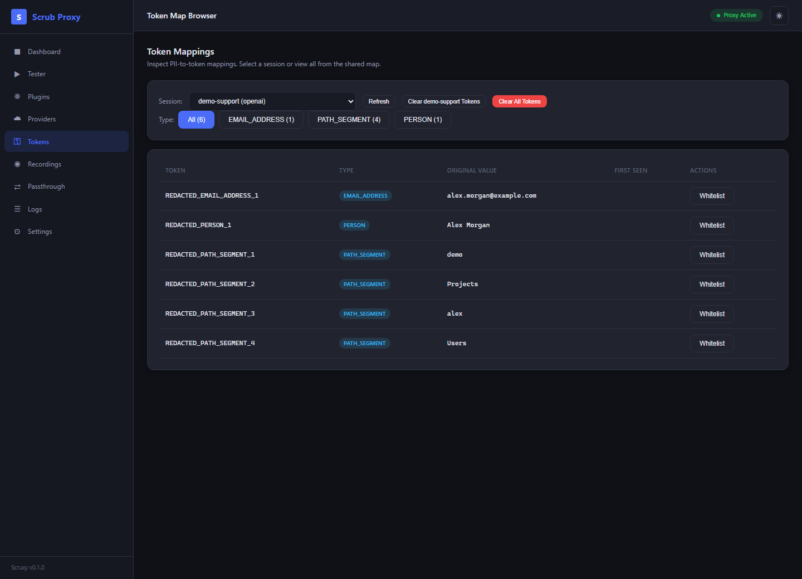
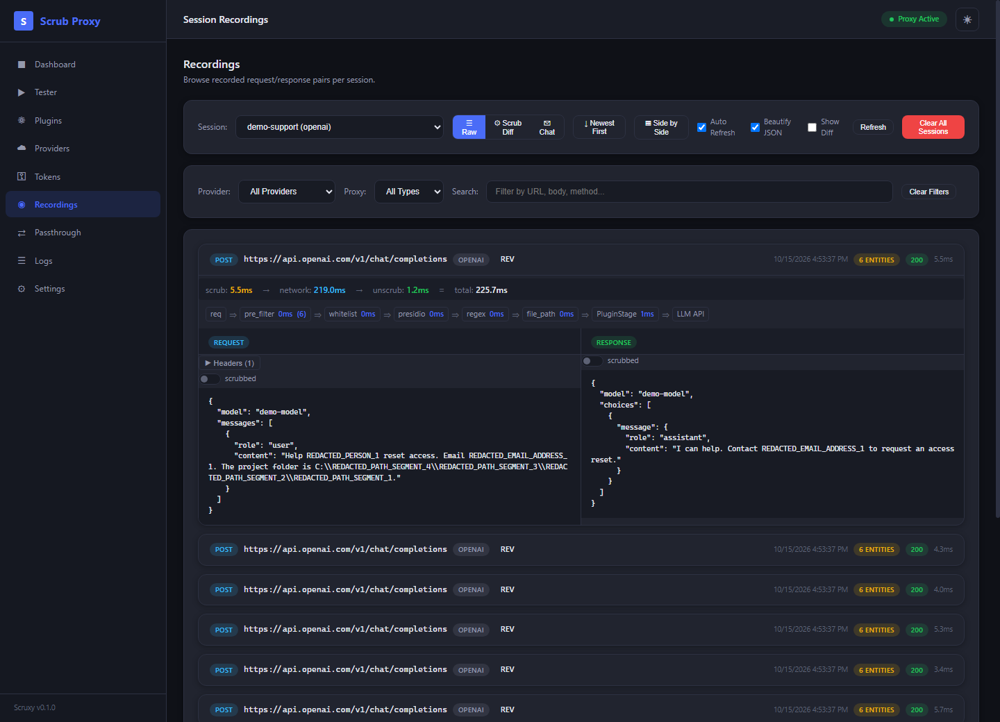
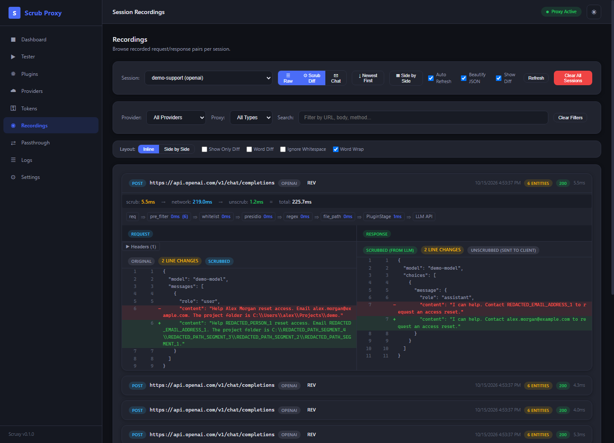
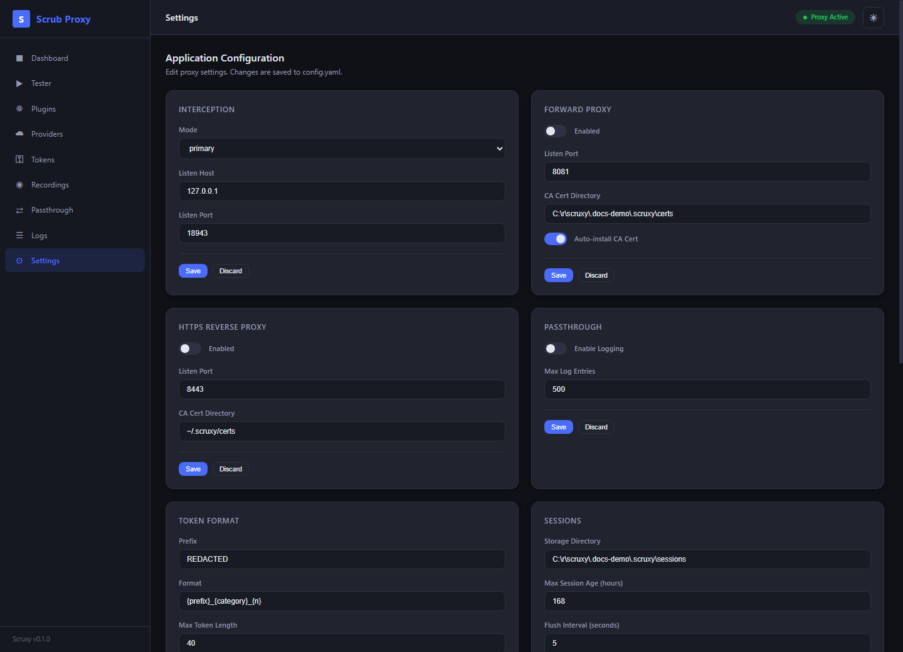

<div align="center">

# Scruxy

### Keep sensitive details local. Keep your assistant useful.

A local PII-scrubbing proxy for Claude Code, GitHub Copilot, and compatible LLM clients.

**Local detection** &nbsp; / &nbsp; **Reversible tokens** &nbsp; / &nbsp; **Streaming responses** &nbsp; / &nbsp; **Built-in dashboard**

[Quick start](#quick-start) · [Feature tour](#feature-tour) · [Connect your assistant](#connect-your-assistant) · [Configuration guide](docs/configuration.md) · [Privacy boundaries](#privacy-boundaries)

</div>



*Real UI, synthetic demo data. Screenshot timings illustrate the interface, not performance benchmarks. [Capture details](docs/screenshots.md).*

## What Scruxy does

Scruxy sits between your coding assistant and its LLM API. It detects PII in supported request text fields, replaces detected values with tokens, and restores those values when the API returns the tokens. Detection runs locally using Microsoft Presidio, spaCy, regex rules, and optional custom detectors.

```text
Your assistant                 Scruxy on your machine                  LLM API
     |                                  |                                 |
     |  "Email alex@example.com"         |                                 |
     | -------------------------------->|  "Email REDACTED_EMAIL_ADDRESS_1"
     |                                  | ------------------------------->|
     |                                  |  "Sent to REDACTED_EMAIL_ADDRESS_1"
     |  "Sent to alex@example.com"       |<--------------------------------|
     |<---------------------------------|                                 |
```

| Capability | What you get |
|---|---|
| **Multiple API formats** | Anthropic Messages, OpenAI Chat Completions and Responses, plus Copilot-specific provider definitions |
| **Two routing options** | Base-URL reverse proxy or standard HTTP/HTTPS forward proxy with CONNECT interception |
| **Layered detection** | Known-PII reuse, whitelisting, NER, regex, file-path detection, and Python plugins |
| **Reversible replacements** | Shared PII-to-token mappings, optional UUID or script-generated replacements, and session-aware restoration |
| **Streaming support** | SSE token restoration, including tokens split across chunks and structured event payloads |
| **An inspectable pipeline** | Local tester, recordings, stage timings, token browser, logs, and dark/light themes |

> [!IMPORTANT]
> Scruxy reduces exposure; it is not a guarantee that every secret or identifier is detected. Unmatched traffic can pass through without scrubbing, and local data can contain original PII. Read [Privacy boundaries](#privacy-boundaries) before using it with sensitive material.

## Quick start

**Requirements:** Python 3.11+, Git, and your assistant's normal upstream authentication. The default detector uses the `en_core_web_lg` spaCy model. No API key is needed for the local Tester.

Use a **source checkout with an editable install**. The current provider loaders read YAML assets from the checkout's `default_config` directory, so keep the checkout in place.

```powershell
git clone https://github.com/shahabmokhtari/scruxy.git
cd scruxy
python -m venv .venv
.\.venv\Scripts\Activate.ps1
python -m pip install -e .
python -m spacy download en_core_web_lg
scruxy --no-forward-proxy --no-https
```

<details>
<summary><strong>macOS / Linux shell commands</strong></summary>

```bash
git clone https://github.com/shahabmokhtari/scruxy.git
cd scruxy
python -m venv .venv
source .venv/bin/activate
python -m pip install -e .
python -m spacy download en_core_web_lg
scruxy --no-forward-proxy --no-https
```

</details>

Open **[localhost:8080/ui/](http://localhost:8080/ui/)**. This first run deliberately enables only the HTTP reverse proxy and UI: it does not need certificate trust or change the trust store. The CLI opens a browser unless you pass `--no-browser`.

### Try it without an upstream API call

1. Open **Tester** and choose an Anthropic or OpenAI sample.
2. Paste synthetic request JSON, then click **Run Test**.
3. Compare **Request JSON**, **Scrubbed Request**, and **Unscrubbed Request**. Copy an actual generated token into **Response JSON** and run again to see response restoration.

The Tester operates locally on the selected JSONPath fields; it does not contact an LLM. It shares the token map with proxy sessions and persists its input, so use fabricated data for demonstrations. Passing this test confirms that sample's local transformation, not your client's routing or every provider-specific extraction path.

## Connect your assistant

Configure the shell that **launches the assistant**, not just the shell running Scruxy. Keep using the client's existing login or API-key mechanism; Scruxy forwards authentication headers rather than provisioning credentials.

### Claude Code or a client with a base-URL setting

With the quick-start proxy running:

```powershell
# Claude Code
$env:ANTHROPIC_BASE_URL = "http://localhost:8080"

# An OpenAI-compatible client that supports OPENAI_BASE_URL
$env:OPENAI_BASE_URL = "http://localhost:8080/v1"
```

For OpenAI SDK-style clients, `/v1` is part of the base URL. Other clients append it themselves; use the form that produces `/v1/chat/completions` or `/v1/responses`. Do not assume every Copilot client honors `OPENAI_BASE_URL`.

<details>
<summary><strong>macOS / Linux environment variables</strong></summary>

```bash
export ANTHROPIC_BASE_URL="http://localhost:8080"
export OPENAI_BASE_URL="http://localhost:8080/v1"
```

</details>

### GitHub Copilot or a client with proxy support

Run `scruxy` to enable the built-in forward proxy (on by default), then configure the client:

```powershell
$env:HTTP_PROXY = "http://localhost:8081"
$env:HTTPS_PROXY = "http://localhost:8081"
$env:NODE_EXTRA_CA_CERTS = "$HOME\.scruxy\certs\scruxy-ca.pem"
```

HTTPS interception requires the client to trust Scruxy's CA. The default CLI configuration attempts to install the CA into the system trust store; review [CA trust and removal](docs/configuration.md#certificate-trust) first. Set `auto_install_ca_cert: false` if you want to manage trust yourself. Node-based clients can use `NODE_EXTRA_CA_CERTS`; other runtimes may need their own CA configuration. Restart the client after changing its environment.

**Confirm routing:** send a harmless synthetic prompt, then inspect **Recordings** for a matching provider and `REV` or `FWD` badge. A running UI alone does not prove your assistant's traffic is being scrubbed.

| Listener | Default | Enabled by default? |
|---|---|---|
| HTTP reverse proxy + UI | `localhost:8080` | Yes |
| HTTP forward proxy / HTTPS CONNECT | `localhost:8081` | Yes |
| HTTPS reverse proxy | `localhost:8443` | **No**; enable in configuration |

> [!NOTE]
> **Legacy mitmproxy mode is retired.** The CLI still accepts `--mode mitmproxy`, but application startup warns and migrates it to `primary` for that run. Use the built-in forward proxy; the optional mitmproxy dependency is not a third supported capture mode.

## Feature tour

### Dashboard: see activity and latency

The [dashboard screenshot above](#scruxy) shows registered providers, request and entity totals, and separate scrub, unscrub, network, and total latency series. Toggle chart series and inspect average, minimum, maximum, p95, and p99 across time windows.

**Use it for:** checking that requests are arriving and distinguishing local detection overhead from upstream response time. Measure with your own payloads; model choice, input length, cache state, and hardware all affect latency.

### Tester: understand a scrub/unscrub round trip



Compare six panels: original request, scrubbed request, restored request, simulated response, restored response, and re-scrubbed response. Select JSONPath fields, vary stages for a test invocation, and inspect detected types, sources, scores, and mappings below the panels.

**Use it for:** debugging missed fields and false positives before connecting an assistant. Test-stage overrides do not change the live pipeline's enabled flags, but mappings are shared.

### Plugins: tune detection and replacement



The Plugins page is the main pipeline editor. Enable or disable detectors, reorder eligible stages, duplicate built-in stages for separate configurations, rename their display labels, and edit file-backed rules. Whitelist stages are kept ahead of other detectors; the known-PII pre-filter has a fixed leading position.

The local **Plugin Repository** lets you manage available detectors. Custom plugins can expose typed configuration forms and persistent key-value storage. The same page manages per-entity replacement rules: default tokens, UUIDs, or trusted local scripts.

**Use it for:** adding organization-specific identifiers, preserving safe vocabulary, or comparing detector configurations. [Regex, plugin, and replacement examples](docs/configuration.md#extend-detection).

### Providers: control matching and text extraction

<details>
<summary><strong>View the provider configuration screen</strong></summary>



</details>

| Provider | Supported format | Implementation |
|---|---|---|
| `anthropic` | Messages, including supported content blocks and tool inputs | Python + YAML defaults |
| `openai` | Chat Completions, content parts, and tool-call arguments | Python + YAML defaults |
| `openai_responses` | Responses input, instructions, outputs, and function arguments | Python + YAML defaults |
| `copilot_chat` | Copilot Chat Completions | YAML + JSONPath |
| `copilot_responses` | Copilot Responses | YAML + JSONPath |

Edit upstream URLs, URL patterns, forwarded auth-header names, session extraction, and request/response text paths. Add custom providers through the UI or files in `~/.scruxy/providers`.

**Use it for:** adapting an API-compatible endpoint or investigating an unmatched request. Custom JSONPath overrides change extraction behavior; preserve all relevant fields, including tool arguments. Provider support does not by itself establish compatibility with every client version or endpoint.

### Tokens: inspect what was replaced

<details>
<summary><strong>View the token browser</strong></summary>



</details>

Browse the shared map or filter by session and entity type. Inspect original values, whitelist false positives, and follow first-seen recording links when available. Per-session clearing preserves entries still shared by other sessions.

**Use it for:** explaining a replacement and fixing overly broad detection. Clearing mappings can make later responses containing those tokens impossible to restore. This page intentionally reveals original PII; do not share live screenshots.

### Recordings: follow a request from scrub to response



Pair requests with responses and inspect status, provider, headers, proxy type, per-stage detection timings, and the **scrub + network + unscrub = total** breakdown. Filter by provider, proxy type, session, or text. Switch between raw JSON and chat views, adjust layout and sort order, and keep expanded rows open during incremental refresh.

<details>
<summary><strong>View a scrub comparison using synthetic original bodies</strong></summary>



</details>

**Use it for:** verifying what a matched request sent upstream or investigating a token that was not restored. Original-body toggles and before/after comparisons require original bodies to have been recorded. `recording.store_body_original` defaults to **false**; enabling it persists PII and only affects subsequent recordings.

### Passthrough, Logs, and Settings

| Page | What it provides | Important detail |
|---|---|---|
| **Passthrough** | Inspect non-provider traffic with method filters, refresh, and log clearing | Logging is off by default. Unmatched traffic is not made safe by appearing in this view; body capture is not enabled by the ordinary logging toggle. |
| **Logs** | Application log ring buffer, level filters, statistics, and PII detection events | WARNING and above are selected initially. The buffer holds 500 entries; disk logs are separate. |
| **Settings** | Section-by-section configuration of listeners, tokens, sessions, recording, logging, statistics, and UI | Some changes apply live; restart for listener and storage changes. Use `--no-browser` to reliably suppress CLI browser launch. |

<details>
<summary><strong>View Settings</strong></summary>



</details>

A compact stage-toggle page also exists at `/ui/pipeline`; the sidebar's **Plugins** page is the richer editor. Dark/light theme and several view preferences persist in browser local storage.

## How detection works

```text
Provider text extraction
  -> known-PII pre-filter
  -> whitelist -> Presidio -> regex -> file paths -> custom plugins
  -> resolve replacements into the shared token map
  -> cross-field second pass
  -> forward request

Response -> restore mapped tokens -> return JSON or stream SSE to the client
```

Stages run with **priority masking**: an earlier detector's spans are protected from later detectors. The request scrubber's second pass revisits fields after new mappings are discovered, catching known PII that appeared in an earlier field.

**Default Presidio categories:** `PERSON`, `EMAIL_ADDRESS`, `PHONE_NUMBER`, `CREDIT_CARD`, `US_SSN`, and `IP_ADDRESS`. Regex and custom plugins add domain-specific types. File-path detection can replace path segments, not only usernames.

**Shared mappings, session-aware restoration:** the same detected value reuses its existing token across sessions while that mapping exists. SQLite persists mappings and session usage by default; `tokens.persistent: false` makes the token store memory-only. This does not turn off recordings, tester-state persistence, or logs.

**Streaming:** the SSE unscrubber buffers partial token prefixes, restores complete tokens, and handles structured event payloads. It can only restore tokens that survive the model's output and still have applicable mappings.

### Optional OpenAI Privacy Filter

The `openai_privacy_filter` plugin runs the open-source [OpenAI Privacy Filter](https://github.com/openai/privacy-filter) locally; it is **not an OpenAI API call**. It is disabled by default and requires the optional `opf` package plus a large model download.

Install from the editable checkout:

```powershell
python -m pip install -e ".[opf]"
```

Edit the **existing** OPF entry in `pipeline.stages`, keeping the other stages intact, and disable Presidio for an initial comparison:

```yaml
- name: openai_privacy_filter
  enabled: true
  config:
    device: cpu
    decode_mode: viterbi
    min_score: 0.5
    max_text_length: 64000
```

It supports eight labels covering accounts, addresses, email, people, phones, URLs, dates, and secrets. Start by comparing it **instead of** Presidio rather than running both. The default 64,000-character input cap skips longer text for this detector, so account for that coverage gap. Its `min_score` is currently a fixed emitted confidence value, not a calibrated probability threshold.

See [installation, configuration, and benchmarking](docs/configuration.md#optional-openai-privacy-filter) before enabling it.

## Privacy boundaries

| Boundary | What to understand |
|---|---|
| **Detection coverage** | Only supported/extracted text and configured detectors are covered. Do not assume images, arbitrary binary content, every JSON field, or every secret format is inspected. Whitelists, disabled detectors, timeouts, and size limits can reduce coverage. |
| **Routing** | Forward-proxy traffic that does not match an enabled provider can pass through unchanged. Unknown routes on the main reverse-proxy port normally return 404 instead. Local loopback forwarding and admin-route restrictions have separate handling. |
| **Authentication** | Credentials still reach the upstream service for authentication. Recordings mask selected sensitive header values; arbitrary headers and metadata are not a general-purpose PII-scrubbing surface. |
| **Local storage** | The token database contains original PII. Tester inputs, opt-in original-body recordings, custom-plugin data, logs, and metadata may also contain sensitive material. Review files before exporting them. |
| **Local administration** | The UI exposes PII and can edit executable plugins/scripts and install optional packages. Keep it on loopback and use it as a single-operator tool, not a public or multi-tenant service. |
| **TLS interception** | Trusting the local CA enables interception. Protect its private key, never distribute it, and remove trust when no longer needed. Do not disable TLS verification as a workaround. |

Scruxy is a configurable privacy layer, not an encrypted vault, network firewall, or compliance certification.

## Configuration and development

The default configuration location is `~/.scruxy/config.yaml`. Missing values use application defaults; file-backed whitelist/regex files and script examples are seeded as needed. Save settings through the UI or provide your own YAML. `--config` chooses the config file but does **not** relocate every runtime-data path.

```powershell
scruxy --config .\config.yaml --no-browser
scruxy --port 9090 --forward-proxy-port 9081
scruxy --help
```

For the complete CLI, CA setup, configuration examples, data layout, extension APIs, and troubleshooting, see **[Configuration and operations](docs/configuration.md)**.

For development with [uv](https://docs.astral.sh/uv/), from the checkout:

```powershell
uv sync --group dev
uv run python -m spacy download en_core_web_lg
uv run pytest
uv run pytest tests/test_token_map.py
uv run ruff check .
```

Development tools are a dependency **group**, not a `dev` extra. The UI is vanilla HTML/CSS/JavaScript served by FastAPI; it has no frontend build step.

| Code area | Responsibility |
|---|---|
| [`app.py`](src/scruxy/app.py), [`__main__.py`](src/scruxy/__main__.py) | Startup, services, configuration, CLI |
| [`providers`](src/scruxy/providers), [`default_config/providers`](default_config/providers) | Request matching and format-specific extraction |
| [`pipeline`](src/scruxy/pipeline), [`plugin`](src/scruxy/plugin) | Detection, masking, built-in/custom detectors |
| [`scrubber`](src/scruxy/scrubber), [`tokenmap`](src/scruxy/tokenmap) | Request transforms, response restoration, persistent mappings |
| [`proxy`](src/scruxy/proxy), [`recording`](src/scruxy/recording) | Forwarding, CONNECT interception, JSONL recordings |
| [`ui`](src/scruxy/ui), [`tests`](tests) | Local control panel and regression coverage |

Historical design documents live in [`docs/plans`](docs/plans); they describe design decisions at the time, not the current operations contract.

## Contributing and support

Scruxy is an open-source local privacy tool. Use [issues](https://github.com/shahabmokhtari/scruxy/issues) to discuss substantial changes and pull requests for review. Follow the repository's [development workflow](CLAUDE.md), include regression coverage for behavioral changes, and never attach live PII, credentials, or private CA keys.

**License:** MIT, as declared in [`pyproject.toml`](pyproject.toml).
